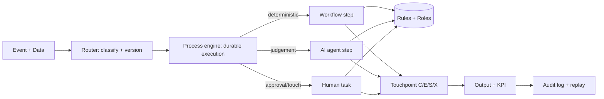

# ARCHITECTURE — runtime options + recommendation

## Scope of this document

This is the **platform architecture that serves every industry** in `industries/`.
Industry-specific structure (org, flows, rules) is not here — it lives in each
industry folder and is validated by `scripts/validate.py`.

Two boundaries are worth stating up front:

- **Business truth vs agent content.** Both live in this repository, per industry
  (`industries/<id>/{rules,flows,pack}`), so prose and the rules it describes share a
  commit and a release tag. The execution platform consumes a *verified bundle*
  (`docs/core/bundles.md`), never a git checkout.
- **Hosted vs split.** `public`/`commercial` industries live here; `restricted`/
  `classified` live in their own repository with a vendored metamodel
  (`docs/core/confidentiality.md`). A tier label does not make content safe to host.

The model itself is described in `README.md` (6 primitives) and
`docs/core/onboarding-industry.md` (how a new industry is added and proven).

## The routing core (one sentence)

Every business situation is an **Event with a typed Data payload**; a **Router** classifies it and starts the matching **Process version**; each step executes as **workflow / AI / human** under **Rules** and **Roles**; every step emits an **Audit event**.

## Agent org (Paperclip) — three planes

Agent work runs on Paperclip (org chart, tickets, heartbeats, approvals,
budgets), but the model and the tenant stay here and in OpenGate:

| Plane | Owns | Where |
|---|---|---|
| design | org, roles, processes, rules, touchpoints, packs, contract pin | this repo |
| execution | tickets, runs, approvals inbox, budgets, skills, connectors | Paperclip (pinned service) |
| tenant + evidence | identity (ONEID), ACL, records, metering, audit, go/no-go | `abn.platform.opengate` |

The model **compiles** into a company template; it is never synced both ways.
Start at `docs/core/paperclip-program.md` (program index), then
`docs/core/paperclip-integration.md` (the contract) and
`docs/core/adr-002-paperclip-three-planes.md` (the ratification). **At field
granularity** — who may write one, which way it flows, and where a re-run resumes —
it is `docs/core/sync-semantics.md`, ratified by `docs/core/adr-003-sync-semantics.md`:
one writer per field, one direction per stream, one watermark. The 600-task
board is the issues labelled `paperclip`.

## Option comparison (read before building)

| Option | Core | Strength | Weakness | Best for |
|--------|------|----------|----------|----------|
| **A. Temporal + Kafka** | code-first durable execution | strongest failure handling, versioning, testability | business users can't read code | bank core: payments, loans, ledger |
| **B. Camunda 8 / Zeebe** | BPMN 2.0 + DMN native | analysts draw, engine runs, DMN for rules | ops cost, less dev-ergonomic than Temporal | compliance-heavy, analyst-owned flows |
| **C. Frappe Workflow + n8n/ActivePieces** | low-code, you already own it | fastest pilot (days), human-task UI free | not durable at bank scale, versioning weak | pilot touchpoints + internal ops |
| **D. Pure AI-agent swarm** | LLM orchestrates everything | flexible for unstructured cases | non-deterministic, unauditable, expensive | REJECT as core; use only at AI steps |

## Recommended hybrid (what the 100 issues implement)

- **Durable core:** Temporal (or Camunda 8 if analysts must own BPMN). One binary per domain, Postgres + Redpanda/Kafka, idempotency keys everywhere.
- **Rules:** DMN tables / OPA + OpenFGA for roles. No rule inside code — rule IDs referenced from process YAML.
- **AI sidecar:** LLM agents ONLY at marked `ai` steps (classify, extract, score, draft) with JSON-schema outputs, evals, and human fallback. Never the router.
- **Human layer:** Frappe / custom inbox for approvals + customer/employee portals. Every task has SLA + escalation.
- **Gateway:** Axum (you own it) fronts everything; Supabase Postgres is system-of-record; PostgREST/Kong patterns you already run stay.
- **Observability + twin:** OpenTelemetry traces per process-instance; event log replayable into a simulator for "what-if" (staffing, SLA, fraud).

## Workflow vs AI vs Human — decision matrix

| Signal | → Workflow | → AI | → Human |
|--------|-----------|------|---------|
| Inputs structured, rule exists | ✅ | | |
| Needs reading/extracting/scoring unstructured | | ✅ (+ schema + eval) | |
| Legal/financial sign-off, complaint, exception over threshold | | | ✅ (with AI draft) |
| Cost of error high + precedent low | | AI proposes | ✅ decides |
| Everything else, first version | | | ✅ then promote L3→L4 with data |

Rule of thumb: **start L3 (auto + human approve), promote to L4 (auto + override) only with 30+ days of clean audit + evals green.**
See `engine/automation-levels.md`.
