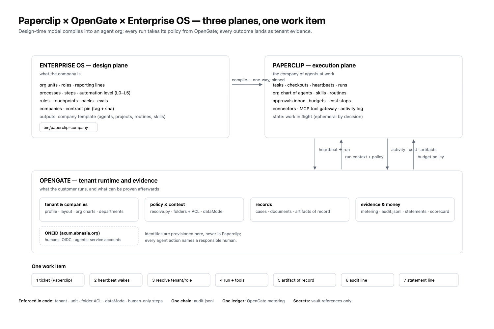

# Paperclip × OpenGate × Enterprise OS — the three-plane integration

**Contract:** `paperclip-boundary@1.0` · **dated** 2026-11-01 · **ratified** by
ADR-002 · **versioning** below.

**Status:** design ratified for the Paperclip program (loop 6) by
`docs/core/adr-002-paperclip-three-planes.md` (ADR-002). Start at
`docs/core/paperclip-program.md` (program index). Program board:
issues labelled `loop:6` + `paperclip`; catalog
`docs/core/prompts/paperclip-catalog.json` (600 tasks in dependency order).



Paperclip is a control plane for a company of AI agents: org chart, task
tickets, heartbeats, approvals, budgets, skills, connectors, run history. It is
not an org model and not an audit record — those already exist here and in
OpenGate. This page fixes the boundary, the seam contracts and the decisions.

**Platform side:** the OpenGate half of this contract (what the tenant plane
implements, the seams as the platform must build them, and the gaps with owners)
is [docs/paperclip-integration.md in `abn.platform.opengate`](https://github.com/stevennt/abn.platform.opengate/blob/DEV/docs/paperclip-integration.md).
Both pages link each other; when one changes, change the other in the same
sitting.

## The three planes

```
┌─────────────────────────────┐        ┌─────────────────────────────┐
│ ENTERPRISE OS — design      │        │ PAPERCLIP — execution       │
│ what the company *is*       │ compile│ the company of agents *at   │
│ org · roles · processes ·   │───────▶│ work*: tickets, heartbeats, │
│ rules · touchpoints · packs │ one-way│ runs, approvals, budgets,   │
│ · companies · contract pin  │        │ skills, connectors          │
└──────────────┬──────────────┘        └──────────────┬──────────────┘
               │ contract + model                     │ activity, cost,
               │ (read at run time)                   │ artifacts
               ▼                                      ▼
┌──────────────────────────────────────────────────────────────────────┐
│ OPENGATE — tenant runtime and evidence                               │
│ identity (ONEID) · tenant/company · org charts · folders/ACL ·       │
│ resolve.py context · records (cases, documents) · metering · audit · │
│ plans/quotas · scorecard / go-no-go                                  │
└──────────────────────────────────────────────────────────────────────┘
```

**One sentence each.** Enterprise OS owns the *model*; Paperclip owns the *work
state*; OpenGate owns the *tenant, the policy and the evidence*. A piece of work
is born as a Paperclip ticket, runs through an OpenGate context, and lands as an
OpenGate record with an audit line; the enterprise model says who may do it and
how far it may go alone.

## Decisions

| # | Decision | Why | Consequence |
|---|---|---|---|
| D1 | **One-way compile**, Enterprise OS → Paperclip company template | two-way sync of an org model is a merge conflict with a payroll attached | changes flow by re-compile + diff; Paperclip edits that matter are promoted back by hand |
| D2 | **Paperclip tickets are work units; OpenGate cases/documents are the durable record** | tasks are ephemeral, evidence is not | no dual-write of task state; a closed ticket must point at its OpenGate record |
| D3 | **Every data access goes through OpenGate tools/API**, never a raw path from an agent | the ACL and `dataMode` must be enforced where data lives | Paperclip connectors for tenant data are disabled; the MCP gateway exposes OpenGate tools only |
| D4 | **ONEID is the only human identity**; agents are OpenGate service accounts with a responsible human | one identity tree, one offboarding | Paperclip local accounts are for break-glass only; every agent action names `responsibleUser`; the seam is [tenant-identity@1](tenant-identity.md) |
| D5 | **OpenGate is billing truth; Paperclip budgets are a throttle** | two ledgers is two invoices | spend reconciles nightly; a budget stop never changes a statement |
| D6 | **Approvals are clicked in Paperclip, decided by the authority grid** | humans want one inbox; the rule is already modelled | `authority_limits` + RACI are imported as approval rules; OpenGate records the decision and the signer |
| D7 | **Secrets live in the vault; Paperclip holds references** | one rotation path | run env is injected at heartbeat; Paperclip secret values are never populated for tenant data |
| D8 | **Company templates carry a contract pin** (`tag` + `sha`) | an agent org must be reproducible months later | import refuses an unresolvable pin; upgrades are explicit |
| D9 | **No prompt-level security** | a prompt is not a control | every boundary is a code check at a tool/API edge, with a denial reason recorded |
| D10 | **Paperclip is a service, not a library** | licence is fine (MIT), the surface is large | pinned version, telemetry off, authenticated bind, vendored adapter only |

### Alternatives considered (and why not)

| Option | Rejected because |
|---|---|
| **Bidirectional sync** between the enterprise model and Paperclip's org chart | two writers to one org is a merge conflict with salaries in it; the first divergence would be discovered in an approval, not a diff |
| **Paperclip as the system of record** for tenant data and audit | it holds work state, not tenancy: no tenant boundary, no folder ACL, no `dataMode`, no billing statement — an audit would have to be reconstructed |
| **Paperclip's secret store for tenant credentials** | a second rotation path and a second place to leak from; the vault already exists and the run env is the only injection point |
| **Two ledgers** (Paperclip spend + OpenGate metering), each billed from | two numbers, two invoices, and an annual reconciliation nobody signs |
| **Mirroring tickets into OpenGate cases** (or the reverse) | every task would have two lifecycles and no tie-breaker; the boundary is a *link*, not a copy |
| **Prompt-level guardrails** instead of code checks | a prompt is not a control; the same agent, prompted differently, would bypass it — the ACL has to live where the data does |
| **Embedding Paperclip as a library** in OpenGate | its surface (server, UI, runners, Postgres) is a service; embedding would fork it and freeze security patches |
| **One Paperclip instance per tenant** | operational multiplication (a Postgres and a runner per customer) for isolation that OpenGate's tenant check already enforces at the data edge |
| **A ONEID session minter in Axum for OpenGate** (API-first only) instead of OIDC | ties every future customer IdP to our identity service; OpenGate's OIDC client already speaks to any provider, so the browser bridge was the smaller change |

## Versioning and the upgrade path

The contract has an id and a version (`paperclip-boundary@MAJOR.MINOR`) because
three systems build against it. What a bump means:

| Change | Version | What the consumers do |
|---|---|---|
| wording, links, a new example | **none** | nothing; fix in place |
| a new seam field, a new owner row, a new gate that does not change direction or ownership | **minor** (1.x) | the compiler emits the same template shape, the adapter keeps running; both sides update their pages in the same sitting |
| a decision reverses (D1–D10), a seam changes direction or ownership, or a field changes hands in the ownership matrix | **major** (2.0) | a **new ADR** ratifies it; every company template is re-compiled; the adapter supports the current and previous major for one release, then drops the old one |

Rules:

- **The pin travels with the artefact.** A company template records
  `boundary: "paperclip-boundary@1.0"`; an adapter run logs the version it ran
  under; the go/no-go scorecard cites it. Version drift becomes visible in the
  record, not in a support call.
- **One version for the whole contract.** The decisions, the ownership matrix and
  the four seams bump together — a seam at 1.1 with decisions at 1.0 is how two
  "current" contracts appear.
- **Ratification is a person.** A major bump needs the ADR (and, once the program
  has one, a second reviewer). A minor bump needs the operator and both pages
  changed together.
- **Upgrade is a re-compile, not a merge.** Because the compile is one-way
  (D1), upgrading Paperclip or the contract means emit → diff → apply; the diff
  is the review surface.

## Ownership matrix (one owner per field)

| Field | Owner | Mirrored to | Never written by |
|---|---|---|---|
| org units, roles (definitions), reporting lines | Enterprise OS | Paperclip org chart | Paperclip UI edits are proposals |
| processes, steps, automation level | Enterprise OS | routines + guard | Paperclip |
| tenant, companies, folders, ACL, dataMode | OpenGate | run context | Paperclip |
| accounts, role assignments, seats | OpenGate | Paperclip members | Paperclip |
| tickets, comments, run logs, approvals UI | Paperclip | activity events | OpenGate |
| cases, documents, artifacts-of-record | OpenGate | links in tickets | Paperclip |
| plans, quotas, statements, metering | OpenGate | budget seeds | Paperclip |
| audit chain | OpenGate | — | Paperclip (it emits events) |
| secrets | vault | run env | both stores |
| contract pin, template version | Enterprise OS | template metadata | Paperclip |

## Seam contracts

1. **Company template** (Enterprise → Paperclip), emitted by `bin/paperclip-company`:
   `{version, company, contract: {tag, sha}, agents[], projects[], routines[],
   skills[], evals[]}`. Every agent cites a role; every routine cites a process
   step and its automation level; an `L0–L2` or `authority: pending-review` step
   cannot compile to an autonomous routine. Shape: `schemas/paperclip-company.json`;
   interface and refusals: `docs/core/paperclip-compiler.md`.
2. **Run context** (OpenGate → Paperclip, resolved per heartbeat):
   `{tenant, company, account, role, unit, dataMode, skills[], acl[], case?}` from
   `gateway/resolve.py`, passed to the adapter as env + a signed context file.
   **Not built yet:** `resolve.py` has no run-context mode today (review finding
   F1); the owning task is PC1-05-02 (#283). Until it exists the adapter must
   fail closed rather than run with a partial context.
3. **Activity event** (Paperclip → OpenGate):
   `{at, tenant, company, agent, responsibleUser, task, run, kind, artifact?,
   cost?, approval?, actor}`; OpenGate appends it to `audit.jsonl` and, for
   billable kinds, to metering.

   **Mapping to the audit line** (the writer exists and signs a hash chain —
   `companies.core.auditAppend`): `actor` = the agent's account id,
   `actorRole` = `agent`, `action` = the event kind (`run.started`,
   `run.finished`, `artifact.linked`, `approval.recorded`), `target` =
   `task`/`run`, `detail` = `{responsibleUser, artifact?, approval?}`. Cost never
   goes into the audit line: it is a metering event (`cost` → the `jobs`/tokens
   dimension). A run that is not billable still gets the audit line and no
   metering event (review finding F2/F9).
4. **Budget policy** (OpenGate → Paperclip):
   `{tenant, company, agent?, limit, window, stop}` seeded from the plan and the
   tenant's overage policy.

## Security model (what is enforced where)

- **Tenant isolation** — at the OpenGate API/tool edge (`tenant` from the signed
  context, never from the prompt).
- **Folder access** — `acl.can(unit, folder, action)`; a denial carries the rule
  and the allowed units, and is recorded.
- **Classification** — `dataMode` per unit and per document; a `mật` document is
  not readable by an agent whose unit lacks it, regardless of what the task says.
- **Approvals** — a human-only step cannot be completed by an agent; the
  approval record names the human, the rule and the authority limit.
- **Secrets** — injected per run from the vault; never in the template, the
  ticket, the prompt or the Paperclip database.
- **No tenant credentials outside the vault** — Paperclip connectors may not hold
  a credential that reaches tenant data; the only path is the OpenGate tool
  surface with the run context. This is a checkable rule (scan the Paperclip
  configuration for tenant endpoints/credentials), not a configuration promise
  (review finding F5).

## The program (600 tasks)

| Tier | Count | What it builds | Workstreams |
|---|---|---|---|
| 1 | 100 | the integration spine: boundary, compiler, adapter, identity, policy, evidence, money, governance, portability, harness | 10 |
| 2 | 200 | the platform surface: connector API, records, onboarding with a crew, admin, readiness, metering, quotas, secrets, residency, PII, observability, reliability, security, groups, sync, migration, docs, testing, release, support | 20 |
| 3 | 300 | industries, pilots and operations: five industry crews, evals, quality, training, three pilot waves, onboarding playbook, capacity, cost, performance, DR, multi-region, GDPR, SOC 2, sector rules, audit, partners, marketplace, analytics, data platform, SRE, on-call, roadmap, close-out | 30 |

Each workstream is decomposed by a ten-step ladder that fits its kind (design,
build, ops, compliance), so the catalog order is the dependency order. The
catalog is generated by `scripts/paperclip-program.py`; the issue map and the
run queue sit beside it.

## Reviews

- `docs/core/paperclip-reviews/PC1-01-02-plane-contract.md` — the boundary
  contract review: nine findings, four resolved in this document, five deferred
  to a named issue.
- `docs/core/audits/plane-boundary-2026-11-01.md` — the audit: eight checks run
  with their exit codes and output digests, the guarded files' sha256, the open
  items and a verdict; re-verifiable with `scripts/audit_boundary.py --verify`.
- `docs/core/adr-002-paperclip-three-planes.md` — the ratification (ADR-002):
  the accepted decision, its consequences, and the conditions that would reverse
  it.

## Non-goals

- no bidirectional task/issue sync (D2);
- no agent with raw filesystem or database access to tenant data (D3);
- no second audit chain, no second cost ledger (D5);
- no secrets in Paperclip for tenant data (D7);
- no autonomous execution of a human-only or pending-review step (D1, D9).
